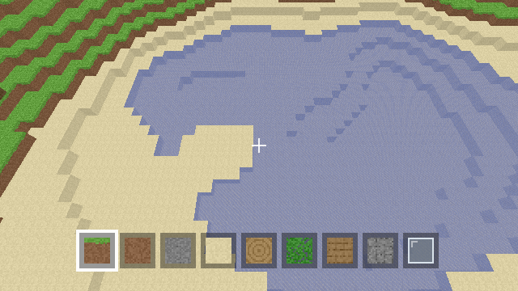

# rustcraft — a Minecraft (Java) clone in Rust + wgpu

A voxel sandbox written from scratch: chunked terrain, block breaking and
placing, first-person movement with gravity and collision, and toggled creative
flight. Rendering uses **[wgpu]**, which compiles to **Vulkan** (Linux/Windows),
**Metal** (macOS), and **DirectX 12** (Windows) — so one codebase runs on all
three. The only platform-specific piece is wgpu itself; the whole game logic is
portable Rust.



## Features

- **World generation** — deterministic hash-based value-noise fBm produces
  hills, valleys, beaches, lakes/oceans, 3-D cave carving, and trees. Same seed
  ⇒ identical world on every machine.
- **Chunked meshing** — 16×16 columns, 96 blocks tall. Faces are culled against
  non-opaque neighbours, so hidden geometry costs nothing; one draw call per
  chunk. Separate **opaque** and **transparent** (water/glass) passes.
- **Procedural textures** — a 15-tile `texture_2d_array` atlas painted in code,
  so the repo ships **no binary image assets**.
- **Movement** — pointer-lock mouse look, swept-per-axis AABB collision,
  gravity, jumping, sprinting, and creative flight (`F`).
- **Interaction** — Amanatides–Woo voxel raycast for breaking/placing, with a
  9-slot hotbar and player-overlap checks so you can't place a block inside
  yourself.
- **Presentation** — distance fog toward the sky colour, and a 2D overlay
  (hotbar + crosshair) drawn in clip space.

## Controls

| Input | Action |
|---|---|
| `W` `A` `S` `D` | Move |
| Mouse | Look (click once to capture the pointer) |
| `Space` | Jump / fly up |
| `Shift` | Sneak / fly down |
| `Ctrl` | Sprint |
| `F` | Toggle creative flight |
| Left / Right click | Break / place block |
| `1`–`9` or scroll | Select hotbar slot |
| `Esc` | Release the mouse (press again to quit) |

## Build & run

### Windows — just launch it

Double-click **`rustcraft.exe`** in the repo root. (It's a normal console
build, so a terminal window opens alongside the game — that's intentional and
shows any startup logs; see *Hiding the console* below to remove it.)

To rebuild from source on Windows:

```sh
cargo run --release
```

### Linux / macOS

```sh
cargo run --release
```

Needs a Vulkan driver (Linux — basically always present) or Metal (macOS,
built in).

### Cross-compile the Windows `.exe` from Linux

```sh
rustup target add x86_64-pc-windows-gnu
sudo apt-get install gcc-mingw-w64-x86-64        # MinGW-w64 toolchain
cargo build --release --target x86_64-pc-windows-gnu
# → target/x86_64-pc-windows-gnu/release/rustcraft.exe
```

### Hiding the console window

Add this as the first line of `src/main.rs` to make the release build a
windowed (console-less) app:

```rust
#![cfg_attr(all(target_os = "windows", not(debug_assertions)), windows_subsystem = "windows")]
```

## Headless screenshot (how the build is verified)

Renders a single frame with no window — handy for CI or machines without a
display. It picks a software Vulkan adapter if one is available:

```sh
cargo run --release -- --screenshot out.png 640 360
```

## Tests

```sh
cargo test
```

Covers noise determinism/range, world generation (bedrock floor, terrain spans
sea level, water generation, determinism), meshing (face culling, winding
matches normals), raycasting (hit + face normals), physics (falling, landing,
wall blocking, jumping), and UI geometry.

## Project layout

| File | Responsibility |
|---|---|
| `src/main.rs` | Event loop, input, game loop, chunk streaming, CLI |
| `src/world.rs` | Terrain generation, block get/set, dirty-chunk tracking |
| `src/noise.rs` | Deterministic hash-based value noise / fBm (2-D & 3-D) |
| `src/chunk.rs` | Chunk storage layout and coordinates |
| `src/mesher.rs` | Face-culled meshing → vertex/index buffers |
| `src/block.rs` | Block types + tile/opacity/collision properties |
| `src/atlas.rs` | Procedural texture atlas painting |
| `src/renderer.rs` | wgpu setup, WGSL shader, pipelines, frame render |
| `src/camera.rs` | First-person camera and view-projection matrices |
| `src/physics.rs` | AABB player movement and voxel collision |
| `src/raycast.rs` | Voxel DDA traversal for block picking |
| `src/ui.rs` | Hotbar + crosshair overlay geometry |

## Not included (yet)

Multiplayer, redstone, mobs, inventory/crafting, lighting/ambient occlusion,
world saving, and mods.

[wgpu]: https://wgpu.rs
